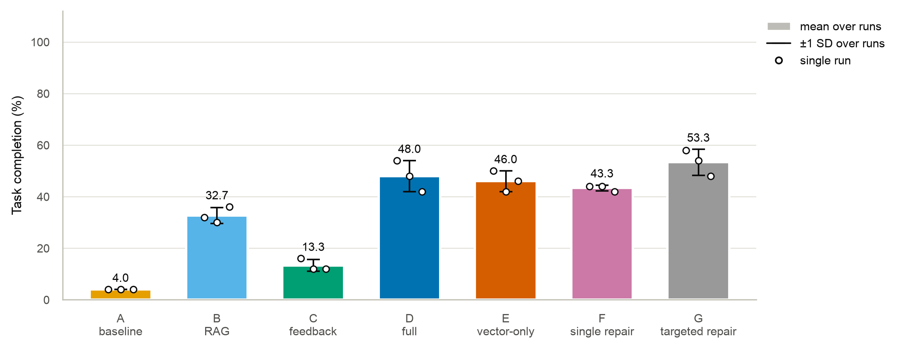
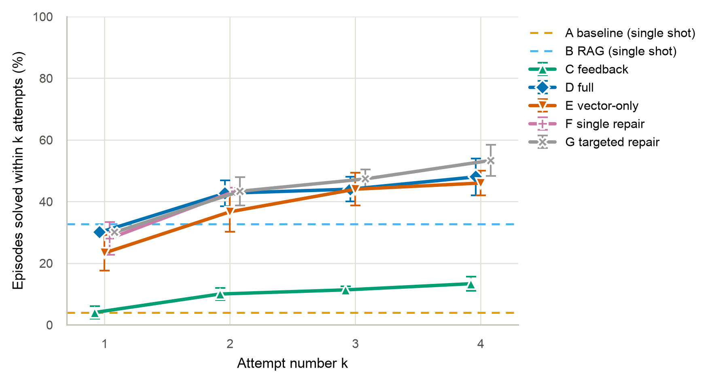
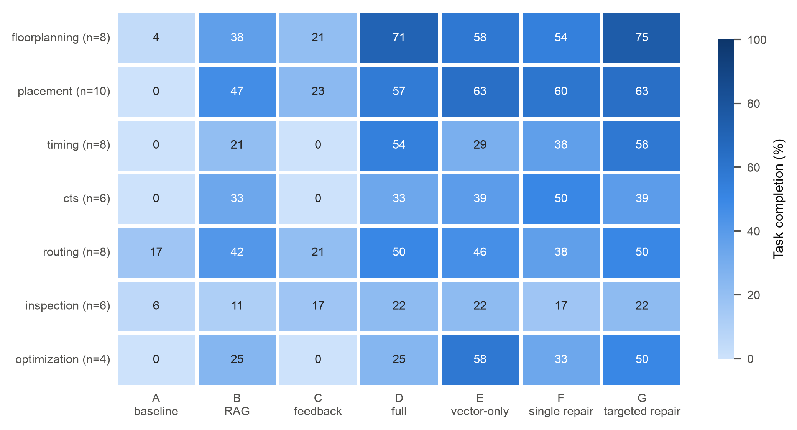

# Improving LLM Reliability in Electronic Design Automation Through Retrieval-Augmented Generation and Execution-Guided Error Correction

## Abstract

Can retrieval-augmented generation (RAG), tool-execution feedback and iterative error
correction make an LLM reliable at ASIC physical-design scripting? We built a 50-task
OpenROAD Tcl benchmark with independent, state-based validators (649 control scripts verify
the validators) and an execution-grounded agent, and ran a six-configuration ablation with a
free local open-weights model (Qwen3.6-35B-A3B, Q4_K_M, non-thinking) on a pinned OpenROAD
build (900 episodes: 6 configurations x 50 tasks x 3 runs). Single-shot generation without
documentation completed 4% of tasks, mostly because it called commands that do not exist in
the installed version. Version-matched hybrid retrieval raised this to 32.7%, and the full
agent (retrieval + execution feedback + up to four attempts) reached 48.0% (paired difference
vs. the baseline +44 pp, 95% CI [32.7, 55.3]). Execution feedback helped much less without
retrieval (13.3%) than with it. Neither hybrid vs. vector-only retrieval (-2.0 pp, CI [-10.0,
5.3]) nor four attempts vs. one repair (-4.7 pp, CI [-12.7, 2.7]) made a statistically
detectable difference, although a single repair used about half the tokens per solved task.
Gains concentrated in easy and medium tasks; hard tasks stayed at 13-18%. The fraction of final
scripts that failed to execute cleanly fell from 94% to 21%, but many remaining failures were
scripts that ran cleanly and did the wrong thing, which the agent's self-check did not detect.
A follow-up configuration that adds the exact syntax card of the failing command to each
repair prompt raised completion to 53.3% (+5.3 pp over the full agent, 95% CI [0.7, 10.7],
p = 0.039). These numbers come from one model and one design, and run-to-run variation is substantial
(full agent: 54%, 48%, 42%), so they should not be read as general estimates.

## 1. Introduction

Large language models now write, debug and repair general-purpose software well enough to
operate as autonomous coding agents. Physical design (PD) for ASICs is a harder environment.
Engineers drive EDA tools through version-specific Tcl command interfaces. Those interfaces
interact with a stateful design database, technology libraries, timing constraints and reports.
A model can understand a PD question and still produce a command that does not exist in the
installed tool version, pass an option the tool rejects, assume a design state that is not
there (placing before a floorplan exists, routing without tracks), or report numbers that look
plausible but were never computed.

This project asks:

> Can retrieval-augmented generation, tool-execution feedback and iterative error correction
> substantially improve the reliability of an LLM performing real ASIC physical-design
> scripting tasks?

Contributions:

1. **A 50-task OpenROAD scripting benchmark** covering seven PD categories. Each task has
   an independent, ground-truth validator. Validators were checked with 649 positive and
   negative control scripts and an adversarial review.
2. **An execution-grounded agent** that combines version-matched hybrid retrieval with
   sandboxed execution, a design-state probe, rule-based error diagnosis and iterative
   repair.
3. **A controlled ablation** over six configurations with three repeated runs and paired
   statistical tests, isolating the contribution of retrieval, execution feedback, repeated
   repair and hybrid (vs. vector-only) retrieval.

This is not the first application of LLMs to chip design (Section 2). The contribution is a
reliability benchmark with independent validation and a controlled ablation of the agent
architecture on a real, pinned EDA tool.

## 2. Background and Related Work

**LLMs for EDA.** ChipNeMo (Liu et al., 2023) adapted LLMs to chip-design domains through
domain-adaptive pretraining and retrieval, including an EDA-script-generation assistant.
ChatEDA (Wu et al., 2023) used an LLM to plan and invoke an RTL-to-GDSII flow built on
OpenROAD through a tool API. EDA Corpus (2024) released question/answer and prompt/script
pairs for OpenROAD. ORAssistant (2024) is a RAG-based conversational assistant for OpenROAD
documentation. Hardware-description-language generation is benchmarked by VerilogEval
(Liu et al., 2023) and RTLCoder (Liu et al., 2023). Compared with these, this project
measures *execution reliability* of PD Tcl scripts against independent, state-based
validators and ablates the agent components.

**Retrieval-augmented generation.** RAG (Lewis et al., 2020) conditions generation on
retrieved documents. Hybrid retrieval combines lexical scoring (BM25; Robertson & Zaragoza,
2009) with dense embeddings (here BGE; Xiao et al., 2023), commonly fused with reciprocal
rank fusion (Cormack et al., 2009). Exact command and option names make lexical matching
important for tool documentation.

**Tool use and self-correction.** ReAct (Yao et al., 2023) interleaves reasoning with tool
actions. Reflexion (Shinn et al., 2023) and Self-Debugging (Chen et al., 2023) use execution
feedback to revise programs. SWE-agent (Yang et al., 2024) shows that the agent–computer
interface strongly affects agent success. This work applies execution-feedback repair to an
EDA tool whose errors are often state-dependent rather than syntactic.

*Note: references are cited from the author's knowledge and should be checked against the
published versions before submission.*

## 3. Methodology

### 3.1 OpenROAD environment

All experiments use OpenROAD 2.0-10927-g0922eecb9 (commit 0922eecb9, November 2023). The
Nangate45 platform and the `gcd` reference design come from OpenROAD's own test suite. The
tool documentation indexed for retrieval comes from the *same* commit (OpenROAD,
OpenSTA submodule) and a contemporaneous OpenROAD-flow-scripts commit, so retrieved syntax
matches the executing binary. Many commands and options differ from newer OpenROAD releases
(e.g. `report_cell_usage` does not exist in this build), which makes version awareness part
of the task.

Starting states are eight immutable database snapshots produced by the reference flow:
`synth`, `fp_init`, `floorplan`, `gplaced`, `placed`, `cts`, `grouted`, `routed`.
A harness preamble loads the snapshot, the liberty file, the SDC and the RC settings. The
agent's script is then `source`d. `exit` is trapped so the harness always regains control.

**Execution interface.** Each execution runs in a fresh directory. The harness returns
a structured result: success, exit code, script status, the failing line, tool errors and
warnings, the classified error type, execution time and artifacts. A harness-owned
**design-state probe** then records the actual database state (die/core, rows, tracks,
placement status and legality, IO pins, power grid, clock network, route guides, detailed
routes, timing summary). Neither the agent's state manager nor the validators ever rely on
the LLM's claims.

**Safety.** A static policy rejects external processes, sockets, interpreter tricks and
harness tampering. A macOS Seatbelt profile denies network and process execution, confines
writes to the run directory and denies reads of the user's home directory. A wall-clock
timeout and a memory watchdog bound every run. Each attempt restarts from the snapshot,
which gives rollback by construction.

### 3.2 Benchmark

| Category | Tasks | Examples |
|---|---:|---|
| Floorplanning | 8 | utilization-driven floorplan; pin placement with edge/order constraints; tap/endcap; PDN; DEF export |
| Placement | 10 | global placement; density targets; legalization with padding/displacement limits; mirroring; detailed-placement optimization; fillers |
| Timing analysis | 8 | worst setup/hold paths; parasitics from placement/global routing; skew; DRV checks; RCX sign-off; slow corner |
| Clock-tree synthesis | 6 | CTS with buffer lists; root-buffer constraints; clustering; clock-tree reports |
| Routing | 8 | global routing with layer limits; guides; detailed routing; wirelength; RC extraction/SPEF; DEF |
| Inspection & reporting | 6 | IO ports; cell usage; fanout; area summary; flip-flop/clock-driver analysis; netlist export |
| Optimization & repair | 4 | input buffering; hold repair; setup repair; DRV repair under tighter limits |

Difficulty: 18 easy, 17 medium, 15 hard. Each task specifies a natural-language instruction
written in engineering terms, without Tcl syntax; a starting state; the required output files
with exact names; the expected commands (for analysis only); and a validator.

**Validators** check outcomes, not commands. They compare the probe and output files with
ground truth computed by trusted Tcl queries on the final database or the starting state,
reloading the original SDC, so relaxing constraints cannot fake a timing result. Reports
are parsed robustly and their numbers compared with ground truth, so a fabricated report
fails. Every validator also requires that the script finished without a Tcl or tool error.

**Validator verification.** Each task has a reference solution and alternative valid
solutions, which must pass. It also has plausible wrong solutions (wrong values, skipped
prerequisites, wrong report type, fabricated reports, destructive shortcuts) and the empty
script, which must fail. I wrote the tasks, validators and controls myself. Each category was then reviewed adversarially
in a separate pass, which proposed additional controls and flagged validators that were too strict or too lenient.
The final validators were then verified by running every control script.
In total, 649 of 649 controls behave as expected across the 50 evaluation tasks and 8
development tasks.

### 3.3 Agent

* **LLM.** Qwen3.6-35B-A3B (a mixture-of-experts model with ~3B active parameters per token),
  4-bit Q4_K_M GGUF, served locally by llama.cpp b11829, non-thinking mode. Sampling follows
  the model card's instruct settings (temperature 0.7, top-p 0.8, top-k 20) with presence
  penalty 0, because code repeats identifiers. A seed is derived per call from
  (experiment, configuration, run, task, attempt). Runs are therefore independent samples but
  exactly reproducible. Non-thinking mode was chosen on a dev task: it was about 4.5× faster
  than thinking mode with the same code-block compliance (`experiments/llm_calibration.json`).
* **Prompt.** A fixed system prompt (expert PD engineer; use only documented commands of the
  stated version; relative paths; no forbidden operations; return one `tcl` block) and a user
  message containing the task and the design context. The design context gives the tool
  version, loaded files, current stage and platform facts. Configurations differ only in the
  optional documentation and feedback sections.
* **Retrieval.** 1,632 chunks from 1,180 documents: tool READMEs, per-command syntax cards from
  `define_cmd_args`, the OpenSTA reference manual, official example scripts, and ORFS scripts
  and docs. Embeddings use BAAI/bge-small-en-v1.5 in a FAISS inner-product index; BM25 uses
  a code-aware tokenizer. Hybrid retrieval fuses the top-8 lists of each with reciprocal rank
  fusion (k = 60) and injects the top 6 (≤ 14,000 characters). On a separate 40-question
  retrieval set, recall@6 is 0.875 (vector), 0.800 (BM25) and 0.925 (hybrid).
* **Feedback loop.** After each execution the agent's own verifier checks three things: a
  clean execution, that the requested output files exist, and that the expected state change
  happened (from generic PD vocabulary, e.g. "global placement" → all cells placed). It never
  sees the benchmark validator. On failure, a rule-based classifier assigns one of the error
  types: invalid command, invalid argument, Tcl syntax, missing prerequisite, missing file,
  incorrect design context, runtime failure, unsafe command, validation failure or tool error.
  The repair prompt then contains the error, the failing line, tool errors and warnings, the
  output tail, the probed design state, the self-check findings, a generic hint for the error
  type and, with RAG, newly retrieved documentation for the error. The conversation is
  append-only, and the model returns a complete corrected script.

### 3.4 Experimental protocol

Six configurations (Table in README): A baseline (single shot); B RAG (single shot);
C feedback + iterative correction without RAG; D full agent; E full agent with vector-only
retrieval; F full agent limited to one repair (two attempts). Each configuration runs all 50
tasks three times (900 episodes). An earlier attempt at F was stopped after 35 episodes; those
records are excluded and F was rerun from scratch. A seventh configuration (G, targeted syntax
cards on repair) was added afterwards as a follow-up and is described in Section 4.9. The model, prompts, design context, snapshots, timeouts (300 s per
execution) and validators are identical across configurations. Success is the validator's
verdict on the final executed script. Prompts were developed only on 8 separate
development tasks; the 50 evaluation tasks were run once, after development was frozen.

Metrics: completion rate (mean ± s.d. over runs); first-attempt success; recovery rate
(episodes whose first attempt failed but whose final attempt passed, over episodes whose
first attempt failed); failed tool executions per episode; final-script execution-failure
rate; error-type distributions; latency and token use. Statistics: paired bootstrap 95% CIs
over tasks; exact McNemar tests on run-matched (task, run) pairs; Wilcoxon signed-rank on
per-task success rates; Holm correction over the planned contrasts.

## 4. Results

All numbers below come from `experiments/results/main/` (900 ablation episodes plus 150 for the
follow-up in Section 4.9, 0 harness errors,
100% coverage). The generated tables are in `paper/tables/` and the figures in `paper/figures/`.

### 4.1 Main results

| Configuration | RAG | Feedback | Max attempts | Completion % (mean ± SD, 3 runs) | Per run % | First-attempt % | Recovery % | Final-script execution failure % | Failed exec./task |
|---|---|---|---:|---:|---|---:|---|---:|---:|
| A_baseline | none | no | 1 | 4.0 ± 0.0 | 4 / 4 / 4 | 4.0 | n/a | 94.0 | 0.94 |
| B_rag | hybrid | no | 1 | 32.7 ± 3.1 | 32 / 30 / 36 | 32.7 | n/a | 57.3 | 0.57 |
| C_feedback | none | yes | 4 | 13.3 ± 2.3 | 16 / 12 / 12 | 4.0 | 9.7 (14/144) | 72.7 | 3.29 |
| D_full | hybrid | yes | 4 | **48.0 ± 6.0** | 54 / 48 / 42 | 31.3 | 24.3 (25/103) | 20.7 | 1.45 |
| E_vector_only | vector | yes | 4 | 46.0 ± 4.0 | 50 / 42 / 46 | 25.3 | 30.4 (34/112) | 24.7 | 1.67 |
| F_single_repair | hybrid | yes | 2 | 43.3 ± 1.2 | 44 / 44 / 42 | 30.0 | 21.9 (23/105) | 40.0 | 0.99 |
| G_targeted_repair (follow-up, 4.9) | hybrid + cards | yes | 4 | 53.3 ± 5.0 | 58 / 54 / 48 | 31.3 | 32.0 (33/103) | 20.7 | 1.42 |

*First-attempt %* is the validator's verdict on attempt 1. It is slightly higher than the k = 1 column
of the cumulative table in Section 4.3, which counts episodes that *ended* successfully after one
attempt. The difference is one task, RT-05, whose correct first attempt the agent's own self-check
rejected (the requested DRC report is empty because the design has no DRC violations, and the
self-check treats an empty requested file as missing output). The agent then kept repairing: 2
such episodes in D and G (both solved again later) and 3 each in E and F (all ended failed).

Standard deviations are over three runs. Configurations A, C and B rank in the same order
(A < C < B) in every run, and all three are below D, E and F in every run. Among D, E and F the
order changes between runs (D led in run 1 and E in run 3), and the full agent's own
run-to-run range (42-54%) is as wide as the gaps between D, E and F.

### 4.2 Planned contrasts

Δ is the paired difference in mean per-task success; the CI is a paired bootstrap over tasks;
p-values are exact McNemar tests on (task, run) pairs, Holm-adjusted over the planned contrasts.

| Contrast | Δ (pp) [95% CI] | McNemar a-only / b-only | Holm p |
|---|---|---|---|
| A vs B (retrieval, single shot) | +28.7 [18.7, 38.7] | 3 / 46 | < 0.001 |
| A vs C (feedback, no retrieval) | +9.3 [3.3, 16.7] | 1 / 15 | 0.002 |
| B vs D (feedback, with retrieval) | +15.3 [7.3, 24.0] | 9 / 32 | 0.002 |
| A vs D (full system vs. baseline) | +44.0 [32.7, 55.3] | 0 / 66 | < 0.001 |
| D vs E (vector-only vs. hybrid) | -2.0 [-10.0, 5.3] | 17 / 14 | 0.720 |
| D vs F (one repair vs. four attempts) | -4.7 [-12.7, 2.7] | 18 / 11 | 0.530 |

Cochran's Q over the six configurations on per-task majority outcomes: Q = 65.8, df = 5,
p < 0.001. The tests on per-task majority outcomes and the Wilcoxon tests are less sensitive
than the run-matched McNemar tests: for B vs. D the Holm-adjusted majority-vote p is 0.116 and for
A vs. C the Holm-adjusted majority-vote p is 0.062 (Wilcoxon 0.052), so the two feedback
effects are less certain than the table alone suggests. The D vs. E and D vs. F contrasts are
not significant under any test, and with 50 tasks and three runs the experiment cannot
distinguish differences of a few points.

### 4.3 Where the gain comes from

* **Retrieval fixes command knowledge.** Without documentation, 60.7% of baseline first attempts
  failed with `invalid_command` and 26.7% with `invalid_argument`. Retrieval cut these to 24.0%
  and 14.7%.
* **Feedback converts errors into passes only when the repair is grounded.** Among episodes
  whose first attempt hit `invalid_command`, the full agent recovered 10 of 29 (34%) and the
  vector-only agent 23 of 46 (50%), but the feedback agent without retrieval only 7 of 96 (7%).
  Without documentation the model has nothing to repair *toward*.
* **Most of the repair benefit arrives on the second attempt.** Cumulative success by attempt
  (mean over runs):

  | Configuration | k=1 | k=2 | k=3 | k=4 |
  |---|---:|---:|---:|---:|
  | C_feedback | 4.0 | 10.0 | 11.3 | 13.3 |
  | D_full | 30.0 | 42.7 | 44.0 | 48.0 |
  | E_vector_only | 23.3 | 36.7 | 44.0 | 46.0 |
  | F_single_repair | 28.0 | 43.3 | - | - |

  In D, the second attempt supplies 12.7 of the 18.0 points gained between one and four attempts.
  Here k = 1 counts episodes that ended after one attempt, so it is below first-attempt success
  by the correct first attempts the self-check rejected (Section 4.1); 1.3 of D's 18.0 points
  re-solve those two RT-05 episodes.
* **The self-check also rejects some correct answers.** In RT-05 the self-check rejected a correct
  first attempt because the requested DRC report was empty, which is the right output for a design
  without DRC violations. D and G re-solved both such episodes; E and F lost all three of theirs
  (E 46.0% and F 43.3% would each be 2 pp higher without these).
* **Semantic failures remain.** At the end, 47 of D's 78 failed episodes were scripts that ran
  cleanly but did not satisfy the validator (E: 44 of 81; F: 25 of 85). The agent's own verifier,
  which never sees the benchmark validator, did not catch them: recovery from a first-attempt
  validation failure was 0 of 15 (D), 0 of 11 (E) and 0 of 16 (F). Execution feedback therefore
  repairs tool errors, not wrong answers.

### 4.4 Category and difficulty

| Category (tasks) | A | B | C | D | E | F |
|---|---:|---:|---:|---:|---:|---:|
| floorplanning (8) | 4.2 | 37.5 | 20.8 | 70.8 | 58.3 | 54.2 |
| placement (10) | 0.0 | 46.7 | 23.3 | 56.7 | 63.3 | 60.0 |
| timing (8) | 0.0 | 20.8 | 0.0 | 54.2 | 29.2 | 37.5 |
| cts (6) | 0.0 | 33.3 | 0.0 | 33.3 | 38.9 | 50.0 |
| routing (8) | 16.7 | 41.7 | 20.8 | 50.0 | 45.8 | 37.5 |
| inspection (6) | 5.6 | 11.1 | 16.7 | 22.2 | 22.2 | 16.7 |
| optimization (4) | 0.0 | 25.0 | 0.0 | 25.0 | 58.3 | 33.3 |

| Difficulty (tasks) | A | B | C | D | E | F |
|---|---:|---:|---:|---:|---:|---:|
| easy (18) | 9.3 | 55.6 | 31.5 | 77.8 | 74.1 | 75.9 |
| medium (17) | 2.0 | 31.4 | 5.9 | 43.1 | 43.1 | 35.3 |
| hard (15) | 0.0 | 6.7 | 0.0 | 17.8 | 15.6 | 13.3 |

Per-category cells contain 4-10 tasks and should be read as indicative only (for example, the
optimization category has 4 tasks). The agent is strong on floorplanning and placement and
weakest on inspection and report-style tasks. On hard tasks it improves only from 0-7% to 13-18%.

### 4.5 Failed executions

The number of failed tool executions depends on how failures are counted, and
the two natural definitions disagree:

* **Failed executions per episode** (every execution that errored, timed out or was rejected by
  the safety policy) did **not** fall for the multi-attempt agents: 0.94 (A), 0.57 (B), 3.29 (C),
  1.45 (D), 1.67 (E), 0.99 (F). Configurations with more attempts execute more times, and each
  failed retry counts.
* **The final submitted script failing to execute cleanly** fell from 94.0% (A) to 20.7% (D) and
  24.7% (E), a 78% relative reduction for D. F, with a single repair, ended at 40.0%. Retrieval
  alone cut failures of the single submitted script from 94.0% to 57.3% (-39% relative).

The first number is a cost of iterating; the second is what a user would see.

### 4.6 Hybrid vs. vector-only retrieval

D (hybrid) is 2 pp above E (vector only), but the CI [-10.0, 5.3] includes zero and every test is
non-significant. Offline, hybrid retrieval was better (recall@6 0.925 vs. 0.875 on the
40-question retrieval set), but that benefit did not show up in end-to-end completion here.

### 4.7 One repair vs. four attempts

F (hybrid retrieval, one repair) completed 43.3%, 4.7 pp below D (CI [-12.7, 2.7], Holm p = 0.530),
which is not a statistically detectable difference. F used about half the resources: 1.66 LLM
calls per task vs. 2.43, 82 s of wall time per task vs. 210 s, and about 21,000 tokens per solved
task vs. about 42,000. F ended with more failed final executions than D (40.0% vs. 20.7%; the largest category was
`tool_error`), but this was offset by fewer scripts that ran cleanly and were wrong (25 vs. 47
failed episodes).

### 4.8 Cost and latency

All LLM calls were free local inference, so no API cost was incurred. Wall time per task was
113.7 s (A), 77.8 s (B), 439.9 s (C), 210.1 s (D), 217.7 s (E) and 81.7 s (F). The baseline was
slower than B because its un-grounded outputs were long (about 2,400 output tokens vs. about
1,250). C was the most expensive per solved task (about 222,000 tokens vs. about 42,000 for D).

### 4.9 Follow-up: targeted syntax cards on repair

The failure analysis above showed that most repairable failures name a specific command.
Configuration G is D with one change: when a repair follows an execution error, the repair
prompt also contains the exact syntax card (the option list parsed from this OpenROAD version's
own command definitions) for the command(s) named in the failing line or the error message. If
the command does not exist in this build, the prompt says so and shows the cards of the
documented commands with the closest names. No extra LLM calls are made.

G replays D's first-attempt generations (identical prompt and replay-cache key; all 150 first
attempts matched D's exactly), so D and G differ only after a failed first attempt. The change was
implemented and checked on the 8 development tasks (G 5 of 8, D 6 of 8 there: a one-task
difference in one run), then frozen and run once on the 50 evaluation tasks, 3 runs.

| | D_full | G_targeted_repair |
|---|---:|---:|
| Completion % (mean ± SD) | 48.0 ± 6.0 | **53.3 ± 5.0** |
| Per run % | 54 / 48 / 42 | 58 / 54 / 48 |
| Recovery after a failed first attempt | 24.3% (25/103) | 32.0% (33/103) |
| Recovered from first-attempt `invalid_command` | 10 / 29 | 13 / 29 |
| Recovered from first-attempt `invalid_argument` | 10 / 28 | 10 / 28 |
| Recovered from first-attempt `tool_error` | 5 / 24 | 8 / 24 |
| Cumulative success at k = 2 / 3 / 4 | 42.7 / 44.0 / 48.0 | 43.3 / 47.3 / 53.3 |
| Final scripts that ran cleanly but were wrong | 47 | 39 |
| Final-script execution failure % | 20.7 | 20.7 |
| Tokens per solved task | about 42,100 | about 37,700 |

Paired comparison (a separate follow-up family, so the planned contrasts are unchanged):
+5.3 pp, 95% CI [0.7, 10.7]; McNemar on (task, run) pairs 2 vs. 10 discordant, p = 0.039;
Wilcoxon p = 0.033; McNemar on per-task majority outcomes 1 vs. 3, p = 0.625. G was ahead in
every run (+4, +6, +6 pp). 168 of the 182 repairs that followed an execution error received at
least one card.

The gain is modest and comes entirely from repairs. In aggregate the extra successes came from
episodes ending as clean-but-wrong scripts (47 to 39), while the share ending in an execution
error was unchanged (20.7%). A plausible reading is that, with the exact option list in front of
it, the model more often chose the option that produces the requested result; we did not verify
this episode by episode. G's wall time
(167 s vs. 210 s per task) is not comparable, because its first attempts were replayed from cache.

## 5. Discussion

**What the data support.** On this benchmark, with this model, grounding in version-matched
documentation was the largest single lever (+28.7 pp), and execution feedback added a further
+15.3 pp on top of it. The two components are better described as complementary than additive:
feedback gave +9.3 pp without retrieval and +15.3 pp with it, and retrieval gave +28.7 pp without
feedback and +34.7 pp with it (C to D, a descriptive comparison that was not a planned contrast).
This fits the failure mode: most failures were knowledge failures (a command that does not exist
in this build), which retrieval addresses directly and which feedback can only fix if the
repair prompt carries the right syntax.

**Diminishing returns from repair.** One repair (F) already achieves most of the four-attempt
result at roughly half the cost, and the second attempt supplies about 70% of the total repair
gain in D. The experiment cannot rule out that a few more points come from additional attempts,
but they would come at a rising cost.

**A failure of the feedback-only agent.** In C_feedback, 62 of the 393 repair attempts began
with free-text deliberation (e.g. "In OpenROAD 2.0, the Clock Tree Synthesis (CTS) might be
handled by a different command or flow...") instead of a script, so the first line was executed
as a Tcl command and failed with `invalid command name "In"`. This happened only in C. Without
documentation the model reasoned aloud about which commands might exist rather than committing
to code. It is a property of this model, prompt and script-extraction implementation, so C should
be read as "feedback in this agent", not "feedback in general". We did not change the agent after
seeing the results.

**Run-to-run variability.** The full agent scored 54%, 48% and 42% in the three runs, a spread
as large as the gaps among D, E and F. Per-call seeds make each run an independent, reproducible
sample, so this variability is sampling noise in the model, and two runs would have
understated it.

**Targeted documentation beats generic documentation at repair time.** The repair prompt already
contained documentation retrieved with the error text. Adding the one card for the command that
failed raised completion by 5.3 pp at no extra model calls. The evidence is moderate (p = 0.039 on
the run-matched test, not significant on the stricter majority-vote test), but it fits the main
finding: what limits this model is exact knowledge of this tool version's commands.

**What the data do not support.** The experiment does not show that hybrid retrieval is better
than vector-only retrieval, that four attempts are better than one repair, or that results carry
over to other models, designs or tool versions.

**Baseline difficulty.** The baseline is probably low in part because the pinned OpenROAD is a
late-2023 build, so many plausible command names do not exist in it; this was not isolated
experimentally. A stronger or thinking-mode model would likely have a higher baseline and less
headroom for retrieval.

## 6. Limitations

* **Three runs.** Standard deviations over three runs are still crude, and the bootstrap CIs
  resample tasks, which captures task sampling better than model sampling variance.
* **One local, quantized, non-thinking model.** Results are for Qwen3.6-35B-A3B at Q4_K_M in
  non-thinking mode. Frontier or thinking-mode models may behave differently.
* **One design, one platform, one tool version.** All tasks use `gcd` on Nangate45 with a single
  pinned OpenROAD build. Tasks on larger designs, macros or different platforms were not tested.
* **Benchmark authorship.** The tasks, validators and agent were all built by me. The
  validators were checked with 649 control scripts and an adversarial review per
  category, but no human PD expert independently audited all 50 tasks.
* **Possible closeness of documentation to tasks.** The knowledge base contains official
  OpenROAD example scripts. Reference solutions were excluded, but official examples can resemble
  the tasks, so retrieval gains may be larger than for entirely novel tasks.
* **Retrieval evaluation optimism.** The 40-question retrieval set had no separate development
  split, so the recall numbers may be optimistic.
* **Weak self-verification.** The agent's self-check cannot detect semantic errors, so repair
  effectiveness is limited to tool errors. It also produces false negatives: it treats an empty
  requested report as missing output, which rejected correct answers on one task (RT-05) and cost
  E and F three episodes each.
* **Restarted configuration.** An earlier attempt at F was stopped after 35 episodes. Those
  records are excluded and F was rerun from scratch under identical settings.
* **Follow-up informed by the evaluation results.** Configuration G was designed after seeing
  which errors the full agent failed to repair on the evaluation tasks. The mechanism uses no
  task-specific information and was frozen after a check on the development tasks only, but a
  modest optimism risk remains, and its p-value (0.039) is not adjusted for being a follow-up.
* **Multiple comparisons.** Holm correction covers the planned contrasts only. Per-category and
  per-difficulty breakdowns are descriptive.
* **Docker environment untested.** The Dockerfile was not executed. The Seatbelt sandbox was the
  isolation used in all experiments.

## 7. Conclusion and Future Work

On a 50-task OpenROAD benchmark, a local open-weights model went from 4% task completion
single-shot to 48% with version-matched retrieval, sandboxed execution feedback and up to four
attempts, a +44 pp paired improvement (95% CI [32.7, 55.3]) over 900 episodes. Retrieval did
most of the work, feedback mattered much more when combined with retrieval, one repair captured
most of the repair benefit at about half the cost, and the remaining errors were increasingly
semantic rather than syntactic. A follow-up that puts the exact syntax card of the failing command
into each repair prompt raised completion further, to 53.3% (+5.3 pp, 95% CI [0.7, 10.7]). The next steps that would most improve the evidence are: a
model-size and thinking-mode sweep; a self-check that verifies results against the design
database; more designs and platforms; and an independent expert audit of the validators.
